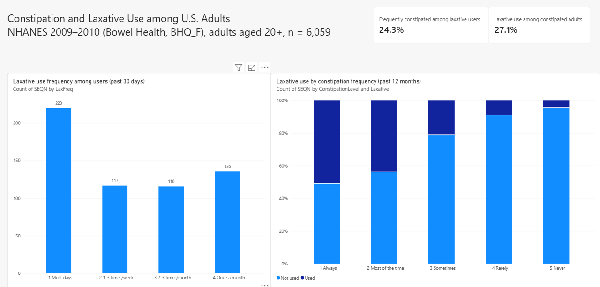

# NHANES Constipation and Laxative Use (Power BI)

Exploratory dashboard on how reported constipation frequency relates to laxative/stool softener use among U.S. adults.

**Goal of this repo:** demonstrate **Power BI** skills (data model, measures, matrix/cross-tabs, KPI cards, multi-page report) on a real public health survey — including the unglamorous steps of getting NHANES from `.xpt` into an analysis-ready table.

### Overview
---

## Business question

Among adults who report constipation, how common is recent laxative use — and does use line up with *low* symptom burden?

In other words: is “take a laxative” a complete story, or do the data suggest we need richer context (diet, routines, lifestyle)?

---

## Data and preprocessing

| Item | Detail |
|------|--------|
| Source | CDC NHANES 2009–2010 |
| Files | **BHQ_F** (Bowel Health), **DEMO_F** (Demographics) |
| Sample | Adults aged 20+, analytic n ≈ 6,059 |
| Access | [NHANES](https://wwwn.cdc.gov/nchs/nhanes/) (public) |

**Preprocessing (before Power BI):**

1. Downloaded SAS transport files (`.xpt`) from CDC  
2. Converted to Excel/CSV (SAS Universal Viewer)  
3. Merged BHQ and DEMO on **SEQN**  
4. Mapped codebook values → labels (`ConstipationLevel`, `Laxative` used / not used)  
5. Built flags (e.g. constipated, high-frequency constipation) for KPIs and cross-tabs  
6. Loaded into Power BI and built the report pages  

This is **unweighted** exploratory work (not official national prevalence estimates).

---

## What the dashboard shows

**Overview**

- KPI: laxative use among adults who report constipation (~**27.1%**)  
- KPI: share of laxative users who still report constipation always / most of the time (~**24.3%**)  
- Laxative-use frequency among users (past 30 days)  
- Stacked view: laxative use by constipation frequency (past 12 months)  

**Detail**

- Cross-tab (%): `ConstipationLevel` × Used / Not used  
- Written key findings tied to those numbers  

---

## Key findings

- Only about **27%** of adults who report constipation used a laxative or stool softener in the past 30 days — most did **not**.  
- Among those constipated **always** or **most of the time**, roughly **half** did not use a laxative in the past 30 days.  
- Among users, about **one in four** still report high-frequency constipation.  

So laxative use is **associated** with higher symptom frequency (as expected), but **use ≠ resolved burden**, and a large share of symptomatic adults are not in the “recent laxative” group.

---

## Conclusion (same logic as my support-ticket analysis)

The available BHQ fields answer a narrow question well: *who reports constipation and who reports recent laxative use.*

They are **not enough** to explain *why* symptoms persist, or what would improve outcomes. There is no depth here on:

- diet / fiber / meal timing  
- physical activity or daily routine  
- medications that can cause constipation  
- stress, sleep, or other lifestyle factors  

**Parallel to the telecom ticket project:**  
region, channel, and plan were weak predictors of CSAT — the honest result was that **better drivers were needed**.  

Here, constipation frequency × laxative use is a useful descriptive slice, but the honest result is the same type: **diet- and lifestyle-related variables (and richer context) are needed** before anyone should claim a full behavioral or product story.

This dashboard is a **Power BI + public-data** piece, not a clinical study and not proof that any product “works.”

---

## Limitations

- Self-reported symptoms and use  
- Cross-sectional (no follow-up)  
- Unweighted sample → exploratory only  
- No treatment-effect or causal claims  
- NHANES 2009–2010 (older cycle; methods still standard for portfolio practice)

---

## Files

- `constipation_laxative.pbix` — Power BI report (if included)  
- `screenshots/` — overview and detail pages  

---

## Skills demonstrated

- Power BI: data load, relationships/merge key (`SEQN`), calculated columns/measures, matrix cross-tabs, KPIs, report layout  
- Survey data practicalities: NHANES file types, codebook mapping, clear limitations  
- Analytical habit: state the question, show the association, say what the data **cannot** support  
